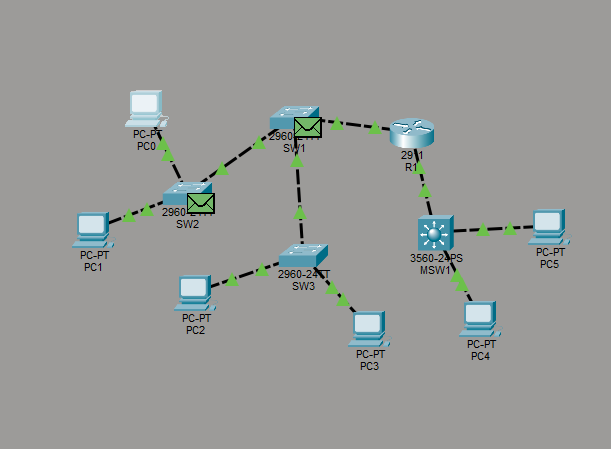
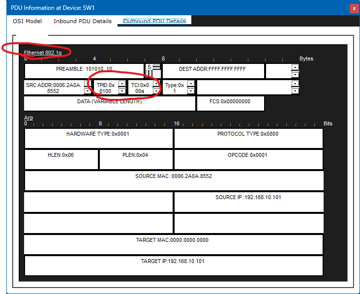

#Отчет по лабораторной работе №3
**Тема:** Lab 3 VLAN, маршрутизация между VLAN
**Выполнил:** Барков Максим гр. 409
## Топология

## Ответы на вопросы
1. 
1.1 
```text
SW2>show vlan brief

VLAN Name                             Status    Ports
---- -------------------------------- --------- -------------------------------
1    default                          active    Fa0/3, Fa0/4, Fa0/5, Fa0/6
                                                Fa0/7, Fa0/8, Fa0/9, Fa0/10
                                                Fa0/11, Fa0/12, Fa0/13, Fa0/14
                                                Fa0/15, Fa0/16, Fa0/17, Fa0/18
                                                Fa0/19, Fa0/20, Fa0/21, Fa0/22
                                                Fa0/23, Gig0/1, Gig0/2
10   STUDENTS                         active    Fa0/1
20   TEACHERS                         active    Fa0/2
99   NATIVE                           active    
1002 fddi-default                     active    
1003 token-ring-default               active    
1004 fddinet-default                  active    
1005 trnet-default                    active    
```

1.2  
```text
SW2>show vlan id 10

VLAN Name                             Status    Ports
---- -------------------------------- --------- -------------------------------
10   STUDENTS                         active    Fa0/1

VLAN Type  SAID       MTU   Parent RingNo BridgeNo Stp  BrdgMode Trans1 Trans2
---- ----- ---------- ----- ------ ------ -------- ---- -------- ------ ------
10   enet  100010     1500  -      -      -        -    -        0      0
```

1.3  
```text
SW1>show interfaces trunk 
Port        Mode         Encapsulation  Status        Native vlan
Fa0/23      on           802.1q         trunking      99
Fa0/24      on           802.1q         trunking      99
Gig0/1      on           802.1q         trunking      99

Port        Vlans allowed on trunk
Fa0/23      10,20,99
Fa0/24      10,20,99
Gig0/1      10,20,99

Port        Vlans allowed and active in management domain
Fa0/23      10,20,99
Fa0/24      10,20,99
Gig0/1      10,20,99

Port        Vlans in spanning tree forwarding state and not pruned
Fa0/23      10,20,99
Fa0/24      10,20,99
Gig0/1      10,20,99
```

2. 
2.1 
 ```text
в Outbound между Source MAC и Type появился 4-байтовый тег 802.1q (TPID=0x8100 + TCI). Именно так коммутатор помечает кадр, уходящий в транк, чтобы принимающая сторона знала, к какому VLAN он относится.
```
2.2 

2.3 
```text
0x000A = 0·16³ + 0·16² + 0·16¹ + 10·16⁰
       = 0 + 0 + 0 + 10
       = 10 (DEC)
```
3. 
```text
SW2 не отправил ARP Request в сторону PC1, потому что широковещательный домен ограничен VLAN: кадр VLAN 10 распространяется только в порты VLAN 10. Fa0/2 принадлежит VLAN 20 — это другой broadcast domain, и кадр туда не уходит.
```
4. 
4.1 
```text
C:\>ping 192.168.20.101

Pinging 192.168.20.101 with 32 bytes of data:

Request timed out.
Reply from 192.168.20.101: bytes=32 time=2ms TTL=127
Reply from 192.168.20.101: bytes=32 time=1ms TTL=127
Reply from 192.168.20.101: bytes=32 time=2ms TTL=127

Ping statistics for 192.168.20.101:
    Packets: Sent = 4, Received = 3, Lost = 1 (25% loss),
Approximate round trip times in milli-seconds:
    Minimum = 1ms, Maximum = 2ms, Average = 1ms
```
4.2 
```text
R1#show ip interface brief
Interface              IP-Address      OK? Method Status                Protocol 
GigabitEthernet0/0     unassigned      YES unset  up                    up 
GigabitEthernet0/0.10  192.168.10.1    YES manual up                    up 
GigabitEthernet0/0.20  192.168.20.1    YES manual up                    up 
GigabitEthernet0/1     10.0.0.1        YES manual up                    up 
GigabitEthernet0/2     unassigned      YES unset  administratively down down 
Vlan1                  unassigned      YES unset  administratively down down
```
4.3
```text
SW1>enable
SW1>show mac address-table 
          Mac Address Table
-------------------------------------------

Vlan    Mac Address       Type        Ports
----    -----------       --------    -----

  10    0009.7cd0.7d01    DYNAMIC     Gig0/1
  20    0009.7cd0.7d01    DYNAMIC     Gig0/1
  99    0009.7cd0.7d01    DYNAMIC     Gig0/1
  ```
  4.4
  ```text
  В таблице MAC-адресов SW1 присутствуют 3 записи с MAC-адресом маршрутизатора R1: в VLAN 10, VLAN 20 и VLAN 99. Коммутатор ведет отдельную таблицу MAC-адресов для каждого VLAN. Сабинтерфейсы R1 используют один и тот же физический MAC-адрес, но коммутатор изучает его в каждом VLAN отдельно, так как кадры приходят с разными тегами. Запись в VLAN 99 появляется потому, что она настроена как Native VLAN на транке. Записи отличаются только полем VLAN.
```
5.
5.1
```text
Cisco Packet Tracer PC Command Line 1.0
C:\>ping 192.168.40.101

Pinging 192.168.40.101 with 32 bytes of data:

Request timed out.
Reply from 192.168.40.101: bytes=32 time<1ms TTL=127
Reply from 192.168.40.101: bytes=32 time<1ms TTL=127
Reply from 192.168.40.101: bytes=32 time<1ms TTL=127

Ping statistics for 192.168.40.101:
    Packets: Sent = 4, Received = 3, Lost = 1 (25% loss),
Approximate round trip times in milli-seconds:
    Minimum = 0ms, Maximum = 0ms, Average = 0ms
   ```
   
   ```text
   C:\>ping 192.168.10.101

Pinging 192.168.10.101 with 32 bytes of data:

Request timed out.
Reply from 192.168.10.101: bytes=32 time<1ms TTL=126
Reply from 192.168.10.101: bytes=32 time<1ms TTL=126
Reply from 192.168.10.101: bytes=32 time=12ms TTL=126

Ping statistics for 192.168.10.101:
    Packets: Sent = 4, Received = 3, Lost = 1 (25% loss),
Approximate round trip times in milli-seconds:
    Minimum = 0ms, Maximum = 12ms, Average = 4ms
```
5.2 
```text
MSW1#show ip interface brief
Interface              IP-Address      OK? Method Status                Protocol 
FastEthernet0/1        unassigned      YES unset  up                    up 
FastEthernet0/2        unassigned      YES unset  up                    up 
FastEthernet0/3        unassigned      YES unset  down                  down 
FastEthernet0/4        unassigned      YES unset  down                  down 
FastEthernet0/5        unassigned      YES unset  down                  down 
FastEthernet0/6        unassigned      YES unset  down                  down 
FastEthernet0/7        unassigned      YES unset  down                  down 
FastEthernet0/8        unassigned      YES unset  down                  down 
FastEthernet0/9        unassigned      YES unset  down                  down 
FastEthernet0/10       unassigned      YES unset  down                  down 
FastEthernet0/11       unassigned      YES unset  down                  down 
FastEthernet0/12       unassigned      YES unset  down                  down 
FastEthernet0/13       unassigned      YES unset  down                  down 
FastEthernet0/14       unassigned      YES unset  down                  down 
FastEthernet0/15       unassigned      YES unset  down                  down 
FastEthernet0/16       unassigned      YES unset  down                  down 
FastEthernet0/17       unassigned      YES unset  down                  down 
FastEthernet0/18       unassigned      YES unset  down                  down 
FastEthernet0/19       unassigned      YES unset  down                  down 
FastEthernet0/20       unassigned      YES unset  down                  down 
FastEthernet0/21       unassigned      YES unset  down                  down 
FastEthernet0/22       unassigned      YES unset  down                  down 
FastEthernet0/23       unassigned      YES unset  down                  down 
FastEthernet0/24       unassigned      YES unset  down                  down 
GigabitEthernet0/1     10.0.0.2        YES manual up                    up 
GigabitEthernet0/2     unassigned      YES unset  down                  down 
Vlan1                  unassigned      YES unset  administratively down down 
Vlan30                 192.168.30.1    YES manual up                    up 
Vlan40                 192.168.40.1    YES manual up                    up
```

```text
MSW1#show ip route
Codes: C - connected, S - static, I - IGRP, R - RIP, M - mobile, B - BGP
       D - EIGRP, EX - EIGRP external, O - OSPF, IA - OSPF inter area
       N1 - OSPF NSSA external type 1, N2 - OSPF NSSA external type 2
       E1 - OSPF external type 1, E2 - OSPF external type 2, E - EGP
       i - IS-IS, L1 - IS-IS level-1, L2 - IS-IS level-2, ia - IS-IS inter area
       * - candidate default, U - per-user static route, o - ODR
       P - periodic downloaded static route

Gateway of last resort is not set

     10.0.0.0/30 is subnetted, 1 subnets
C       10.0.0.0 is directly connected, GigabitEthernet0/1
S    192.168.10.0/24 [1/0] via 10.0.0.1
C    192.168.30.0/24 is directly connected, Vlan30
C    192.168.40.0/24 is directly connected, Vlan40
```
