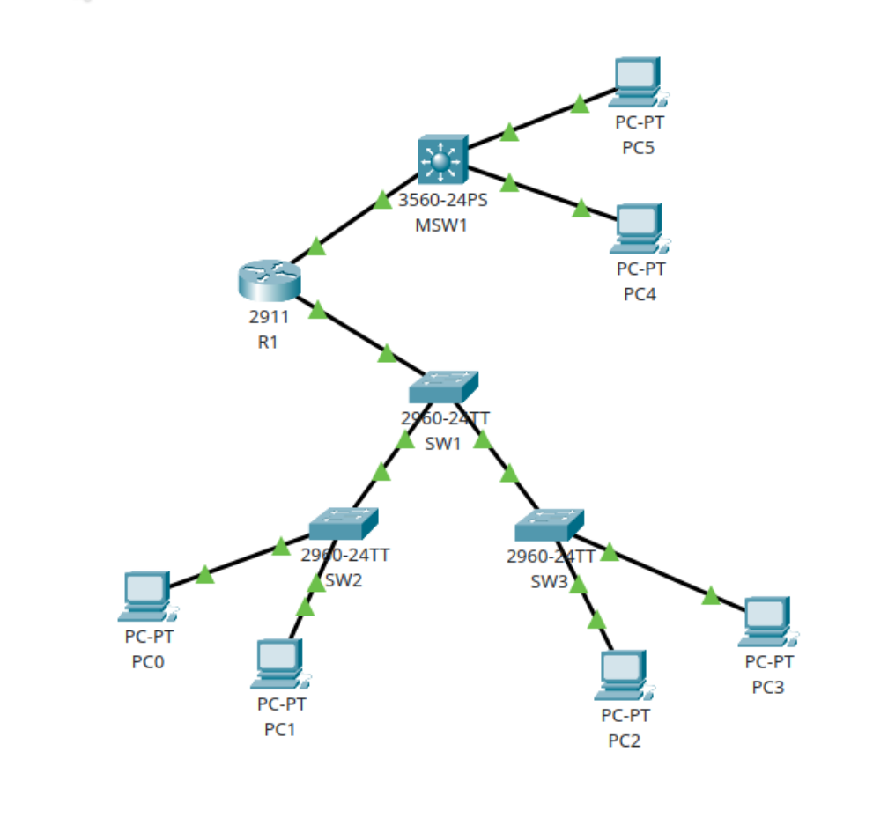
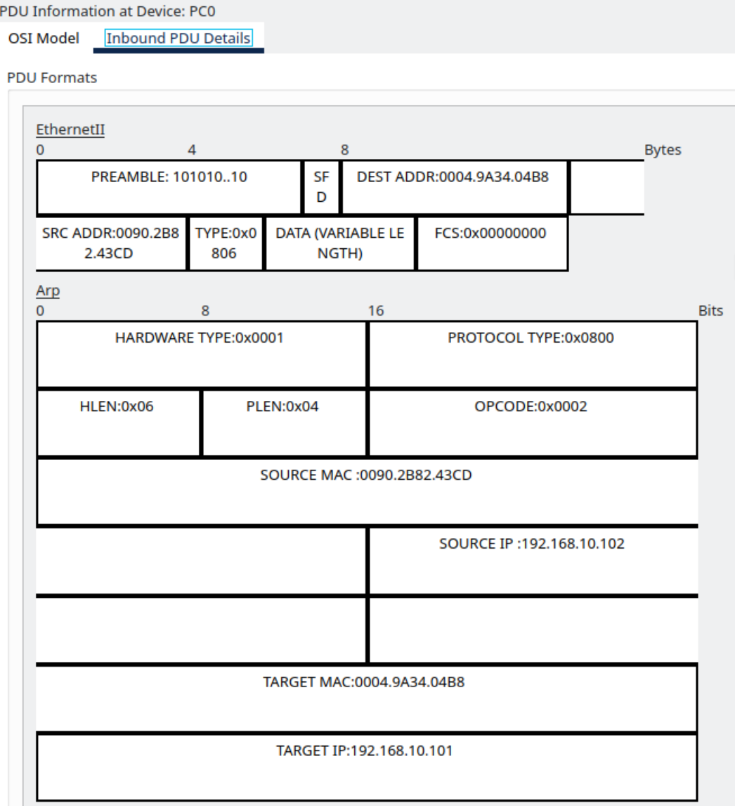

# Лабораторная работа №3. VLAN, маршрутизация между VLAN

**Выполнили:** Капустин, Веселова, Поликарпова  
**Группа:** 439

## Топология


## Вопрос 1

**Какие VLAN есть на SW2? Какие интерфейсы находятся в VLAN 10? Что показывает `show interfaces trunk` на SW1?**

На SW2 созданы VLAN 10 (STUDENTS), VLAN 20 (TEACHERS) и VLAN 99 (NATIVE). Также присутствует VLAN 1 по умолчанию. В VLAN 10 находится порт Fa0/1, подключённый к PC0.

Вывод `SW2#show vlan brief`:

```text
SW2#show vl bri

VLAN Name                             Status    Ports
---- -------------------------------- --------- -------------------------------
1    default                          active    Fa0/1, Fa0/2, Fa0/3, Fa0/4
                                                Fa0/5, Fa0/6, Fa0/7, Fa0/8
                                                Fa0/9, Fa0/10, Fa0/11, Fa0/12
                                                Fa0/13, Fa0/14, Fa0/15, Fa0/16
                                                Fa0/17, Fa0/18, Fa0/19, Fa0/20
                                                Fa0/21, Fa0/22, Fa0/23, Fa0/24
                                                Gig0/1, Gig0/2
10   STUDENTS                         active    
20   TEACHERS                         active    
99   NATIVE                           active    
1002 fddi-default                     active    
1003 token-ring-default               active    
1004 fddinet-default                  active    
1005 trnet-default                    active    
```

Вывод `SW2#show vlan id 10`:

```text
SW2#show vlan id 10

VLAN Name                             Status    Ports
---- -------------------------------- --------- -------------------------------
10   STUDENTS                         active    

VLAN Type  SAID       MTU   Parent RingNo BridgeNo Stp  BrdgMode Trans1 Trans2
---- ----- ---------- ----- ------ ------ -------- ---- -------- ------ ------
10   enet  100010     1500  -      -      -        -    -        0      0
```

На SW1 настроены три магистральных интерфейса: Gi0/1, Fa0/23 и Fa0/24. Для них разрешены VLAN 10 и 20, Native VLAN — 99.

Вывод `SW1#show interfaces trunk`:

```text
SW1#show interfaces trunk
Port        Mode         Encapsulation  Status        Native vlan
Fa0/23      on           802.1q         trunking      99
Fa0/24      on           802.1q         trunking      99
Gig0/1      on           802.1q         trunking      99

Port        Vlans allowed on trunk
Fa0/23      10,20
Fa0/24      10,20
Gig0/1      10,20

Port        Vlans allowed and active in management domain
Fa0/23      10,20
Fa0/24      10,20
Gig0/1      10,20

Port        Vlans in spanning tree forwarding state and not pruned
Fa0/23      10,20
Fa0/24      10,20
Gig0/1      10,20
```

## Вопрос 2

**Чем отличаются заголовки Ethernet в Inbound и Outbound PDU Details? Чему равно значение TCI?**

В Inbound PDU Details кадр поступает на access-порт без тега 802.1Q. В Outbound PDU Details при передаче через trunk-коммутатор добавляет тег 802.1Q, содержащий номер VLAN.

PC0 находится в VLAN 10, поэтому VID равен 10. При нулевых значениях PCP и DEI поле TCI имеет значение `0x000A` в HEX, что равно **10** в DEC.

```text
TCI (HEX): 0x000A
TCI (DEC): 10
VID:       10
```



## Вопрос 3

**В каких VLAN находятся PC0 и PC1? Почему SW2 не отправил ARP Request в сторону PC1?**

PC0 находится в VLAN 10 (STUDENTS), а PC1 — в VLAN 20 (TEACHERS). ARP Request от PC0 является широковещательным кадром VLAN 10. Коммутатор распространяет его только внутри VLAN 10, поэтому кадр не отправляется через порт Fa0/2 к PC1, который принадлежит VLAN 20.

## Вопрос 4

**Результат ping между PC0 и PC1. Вывод `show ip interface brief` на R1. Вывод `show mac address-table` на SW1. Сколько записей с MAC-адресом R1 и почему?**

PC0 (`192.168.10.101`) и PC1 (`192.168.20.101`) находятся в разных VLAN. После настройки сабинтерфейсов R1 связь между ними обеспечивается маршрутизацией Router-on-a-stick.

Результат `ping 192.168.20.101` с ПК0:

```text
C:\>ping 192.168.20.101

Pinging 192.168.20.101 with 32 bytes of data:

Reply from 192.168.20.101: bytes=32 time=82ms TTL=127
Reply from 192.168.20.101: bytes=32 time<1ms TTL=127
Reply from 192.168.20.101: bytes=32 time<1ms TTL=127
Reply from 192.168.20.101: bytes=32 time<1ms TTL=127

Ping statistics for 192.168.20.101:
    Packets: Sent = 4, Received = 4, Lost = 0 (0% loss),
Approximate round trip times in milli-seconds:
    Minimum = 0ms, Maximum = 82ms, Average = 20ms
```

Вывод `R1#show ip interface brief`:

```text
R1#show ip interface brief
Interface              IP-Address      OK? Method Status                Protocol 
GigabitEthernet0/0     unassigned      YES unset  up                    up 
GigabitEthernet0/0.10  192.168.10.1    YES manual up                    up 
GigabitEthernet0/0.20  192.168.20.1    YES manual up                    up 
GigabitEthernet0/1     10.0.0.1        YES manual up                    up 
GigabitEthernet0/2     unassigned      YES unset  administratively down down 
Vlan1                  unassigned      YES unset  administratively down down
```

Пример вывода `SW1#show mac address-table`:

```text
SW1#show mac address-table
          Mac Address Table
-------------------------------------------

Vlan    Mac Address       Type        Ports
----    -----------       --------    -----

   1    000d.bd8a.6037    DYNAMIC     Fa0/23
   1    00d0.ffa0.0c18    DYNAMIC     Fa0/24
  10    0004.9a34.04b8    DYNAMIC     Fa0/23
  10    00d0.97dd.2701    DYNAMIC     Gig0/1
  20    0030.f242.81be    DYNAMIC     Fa0/23
  20    00d0.97dd.2701    DYNAMIC     Gig0/1
```

MAC-адрес R1 отображается в двух записях: одна относится к VLAN 10, другая — к VLAN 20. Коммутатор ведёт таблицу MAC-адресов отдельно для каждого VLAN. Один и тот же физический интерфейс маршрутизатора используется сабинтерфейсами обоих VLAN, поэтому MAC-адрес может совпадать, а записи отличаются номером VLAN.

## Вопрос 5

**Результаты ping. Выводы `show ip interface brief` и `show ip route` на MSW1.**

PC4 (`192.168.30.101`) и PC5 (`192.168.40.101`) находятся в разных VLAN. Маршрутизация между ними выполняется многоуровневым коммутатором MSW1 через SVI.

Результат `ping 192.168.40.101` на ПК4:

```text
C:\>ping 192.168.40.101

Pinging 192.168.40.101 with 32 bytes of data:

Reply from 192.168.40.101: bytes=32 time<1ms TTL=127
Reply from 192.168.40.101: bytes=32 time<1ms TTL=127
Reply from 192.168.40.101: bytes=32 time<1ms TTL=127
Reply from 192.168.40.101: bytes=32 time<1ms TTL=127

Ping statistics for 192.168.40.101:
    Packets: Sent = 4, Received = 4, Lost = 0 (0% loss),
Approximate round trip times in milli-seconds:
    Minimum = 0ms, Maximum = 0ms, Average = 0ms
```

После настройки статических маршрутов PC4 может обращаться к PC0 через R1 и MSW1.

Результата `ping 192.168.10.101` на ПК4:

```text
C:\>ping 192.168.10.101

Pinging 192.168.10.101 with 32 bytes of data:

Reply from 192.168.10.101: bytes=32 time=1ms TTL=126
Reply from 192.168.10.101: bytes=32 time<1ms TTL=126
Reply from 192.168.10.101: bytes=32 time<1ms TTL=126
Reply from 192.168.10.101: bytes=32 time<1ms TTL=126

Ping statistics for 192.168.10.101:
    Packets: Sent = 4, Received = 4, Lost = 0 (0% loss),
Approximate round trip times in milli-seconds:
    Minimum = 0ms, Maximum = 1ms, Average = 0ms
```

Вывод `MSW1#show ip interface brief`:

```text
MSW1#sho ip int br
Interface              IP-Address      OK? Method Status                Protocol 
FastEthernet0/1        unassigned      YES unset  up                    up 
FastEthernet0/2        unassigned      YES unset  up                    up 
FastEthernet0/3        unassigned      YES unset  administratively down down 
FastEthernet0/4        unassigned      YES unset  administratively down down 
FastEthernet0/5        unassigned      YES unset  administratively down down 
FastEthernet0/6        unassigned      YES unset  administratively down down 
FastEthernet0/7        unassigned      YES unset  administratively down down 
FastEthernet0/8        unassigned      YES unset  administratively down down 
FastEthernet0/9        unassigned      YES unset  administratively down down 
FastEthernet0/10       unassigned      YES unset  administratively down down 
FastEthernet0/11       unassigned      YES unset  administratively down down 
FastEthernet0/12       unassigned      YES unset  administratively down down 
FastEthernet0/13       unassigned      YES unset  administratively down down 
FastEthernet0/14       unassigned      YES unset  administratively down down 
FastEthernet0/15       unassigned      YES unset  administratively down down 
FastEthernet0/16       unassigned      YES unset  administratively down down 
FastEthernet0/17       unassigned      YES unset  administratively down down 
FastEthernet0/18       unassigned      YES unset  administratively down down 
FastEthernet0/19       unassigned      YES unset  administratively down down 
FastEthernet0/20       unassigned      YES unset  administratively down down 
FastEthernet0/21       unassigned      YES unset  administratively down down 
FastEthernet0/22       unassigned      YES unset  administratively down down 
FastEthernet0/23       unassigned      YES unset  administratively down down 
FastEthernet0/24       unassigned      YES unset  administratively down down 
GigabitEthernet0/1     10.0.0.2        YES manual up                    up 
GigabitEthernet0/2     unassigned      YES unset  administratively down down 
Vlan1                  unassigned      YES unset  administratively down down 
Vlan30                 192.168.30.1    YES manual up                    up 
Vlan40                 192.168.40.1    YES manual up                    up
```

Вывод `MSW1#show ip route`:

```text
MSW1#sho ip rou
Codes: C - connected, S - static, I - IGRP, R - RIP, M - mobile, B - BGP
       D - EIGRP, EX - EIGRP external, O - OSPF, IA - OSPF inter area
       N1 - OSPF NSSA external type 1, N2 - OSPF NSSA external type 2
       E1 - OSPF external type 1, E2 - OSPF external type 2, E - EGP
       i - IS-IS, L1 - IS-IS level-1, L2 - IS-IS level-2, ia - IS-IS inter area
       * - candidate default, U - per-user static route, o - ODR
       P - periodic downloaded static route

Gateway of last resort is not set

     10.0.0.0/30 is subnetted, 1 subnets
C       10.0.0.0 is directly connected, GigabitEthernet0/1
S    192.168.10.0/24 [1/0] via 10.0.0.1
C    192.168.30.0/24 is directly connected, Vlan30
C    192.168.40.0/24 is directly connected, Vlan40
```
