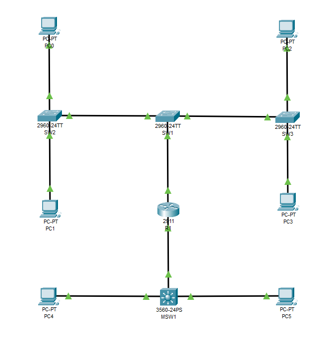
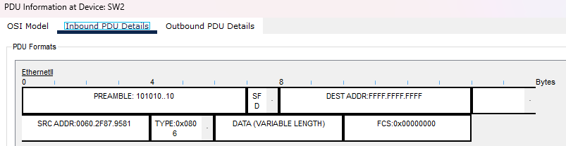
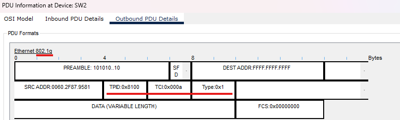
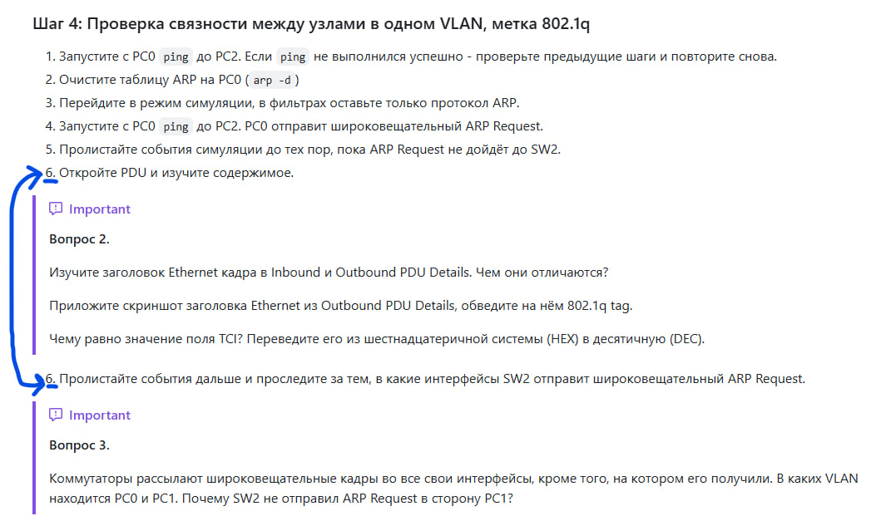

# Отчёт по лабораторной работе 1.3
**Тема:** VLAN, маршрутизация между VLAN  
**Выполнил:** Малыгин А. С., гр. 539  

## Топология
  
## Ответы на вопросы  
1. **Приведите вывод команды show vlan brief на SW2 для просмотра информации о VLAN на коммутаторе. Какие VLAN есть на коммутаторе?**
```
SW2#sh vl br

VLAN Name                             Status    Ports
---- -------------------------------- --------- -------------------------------
1    default                          active    Fa0/3, Fa0/4, Fa0/5, Fa0/6
                                                Fa0/7, Fa0/8, Fa0/9, Fa0/10
                                                Fa0/11, Fa0/12, Fa0/13, Fa0/14
                                                Fa0/15, Fa0/16, Fa0/17, Fa0/18
                                                Fa0/19, Fa0/20, Fa0/21, Fa0/22
                                                Fa0/23, Gig0/1, Gig0/2
10   STUDENTS                         active    Fa0/1
20   TEACHERS                         active    Fa0/2
99   NATIVE                           active    
1002 fddi-default                     active    
1003 token-ring-default               active    
1004 fddinet-default                  active    
1005 trnet-default                    active    
```
На SW2 есть следующие VLAN-ы:
* VLAN 1 - системный, вшитый в ОС vlan;
* VLAN 10 - vlan для студенческого трафика;
* VLAN 20 - vlan для трафика учителей;
* VLAN 99 - vlan "по умолчанию" вместо первого системного;
* VLAN 1002-1005 - рудиментарные vlan-ы, не удалены, чтобы ничего не сломалось внутри ОС.  
  
**Приведите вывод команды show vlan id 10 на SW2 для просмотра информации о VLAN 10. Какие интерфейсы находятся в VLAN10?**  
```
SW2#sh vl id 10

VLAN Name                             Status    Ports
---- -------------------------------- --------- -------------------------------
10   STUDENTS                         active    Fa0/1
```  
В VLAN 10 находится access-интерфейс Fa0/1.  

**Приведите вывод команды show interfaces trunk на SW1 для просмотра информации о магистральных интерфейсах коммутатора.**  
```
SW1#sh int tr 
Port        Mode         Encapsulation  Status        Native vlan
Fa0/23      on           802.1q         trunking      99
Fa0/24      on           802.1q         trunking      99
Gig0/1      on           802.1q         trunking      99

Port        Vlans allowed on trunk
Fa0/23      2-1005
Fa0/24      2-1005
Gig0/1      2-1005

Port        Vlans allowed and active in management domain
Fa0/23      10,20,99
Fa0/24      10,20,99
Gig0/1      10,20,99

Port        Vlans in spanning tree forwarding state and not pruned
Fa0/23      10,20,99
Fa0/24      10,20,99
Gig0/1      10,20,99
```  
  
2. **Изучите заголовок Ethernet кадра в Inbound и Outbound PDU Details. Чем они отличаются?**  

  

Inbound-кадр является нетегированным, поскольку приходит на access-порт, а Outbound-кадр является тегированным (dot1q), т.к. отсылается на trunk-порт.  
**Чему равно значение поля TCI? Переведите его из шестнадцатеричной системы (HEX) в десятичную (DEC).**  
TCI = 0x000A (HEX) = 10 (DEC) = VLAN 10 (STUDENTS)  

3. **Пролистайте события дальше и проследите за тем, в какие интерфейсы SW2 отправит широковещательный ARP Request. Коммутаторы рассылают широковещательные кадры во все свои интерфейсы, кроме того, на котором его получили. В каких VLAN находится PC0 и PC1. Почему SW2 не отправил ARP Request в сторону PC1?**   

PC0 находится в VLAN 10 (STUDENTS), а PC1 в VLAN 20 (TEACHERS). Из-за того, что интерфейсы находятся в разных VLAN-ах, SW2 пересылает кадр только на SW1 (т.е. только на VLAN 10 интерфейсы)  

*Раз уж заметил:*
  

4. **Приведите вывод команды ping между PC0 и PC1.**  
```
C:\>ping 192.168.20.101

Pinging 192.168.20.101 with 32 bytes of data:

Reply from 192.168.20.101: bytes=32 time<1ms TTL=127
Reply from 192.168.20.101: bytes=32 time=2ms TTL=127
Reply from 192.168.20.101: bytes=32 time<1ms TTL=127
Reply from 192.168.20.101: bytes=32 time<1ms TTL=127
```  
**Приведите вывод команды show ip interface brief на R1.**
```
R1#sh ip int br
Interface              IP-Address      OK? Method Status                Protocol 
GigabitEthernet0/0     unassigned      YES unset  up                    up 
GigabitEthernet0/0.10  192.168.10.1    YES manual up                    up 
GigabitEthernet0/0.20  192.168.20.1    YES manual up                    up 
GigabitEthernet0/1     10.0.0.1        YES manual up                    up 
GigabitEthernet0/2     unassigned      YES unset  administratively down down 
Vlan1                  unassigned      YES unset  administratively down down
```  
**Приведите вывод команды show mac address-table на SW1.**  
```
SW1#sh mac address-table 
          Mac Address Table
-------------------------------------------

Vlan    Mac Address       Type        Ports
----    -----------       --------    -----

  10    0001.4356.ce01    DYNAMIC     Gig0/1
  10    0060.2f87.9581    DYNAMIC     Fa0/23
  20    0001.4356.ce01    DYNAMIC     Gig0/1
  20    0002.1707.b7a0    DYNAMIC     Fa0/23
  99    0001.4356.ce01    DYNAMIC     Gig0/1
```
**Найдите в таблице MAC-адрес маршрутизатора R1. Сколько записей с этим MAC вы видите? Объясните, почему их именно столько, и чем эти записи отличаются друг от друга.**  
Всего записи 3, которые различаются принадлежностью к разным VLAN:
* **VLAN 10    0001.4356.ce01    DYNAMIC     Gig0/1** - Эту запись коммутатор делает, когда роутер отправляет кадр с тегом 0x000A (VLAN 10) на SW1. К этому моменту PC1 уже отвечает на эхо-запрос и роутер отправляет кадр на PC0.
* **VLAN 20    0001.4356.ce01    DYNAMIC     Gig0/1** - Эту запись коммутатор делает, когда роутер отправляет кадр с тегом 0x0014 (VLAN 20) на SW1. Здесь эхо-запрос только начинается и роутер отправляет кадр на PC1.
* **VLAN 99    0001.4356.ce01    DYNAMIC     Gig0/1** - Запись, полученная в результате служебных сообщений, отправленных уже после эхо-запросов.  
  
5. **Запустите ping с PC4 до PC5. Запустите ping с PC4 до PC0. Приложите результаты выполнения ping.**  
```
C:\>ping 192.168.40.101

Pinging 192.168.40.101 with 32 bytes of data:

Reply from 192.168.40.101: bytes=32 time<1ms TTL=127
Reply from 192.168.40.101: bytes=32 time<1ms TTL=127
Reply from 192.168.40.101: bytes=32 time<1ms TTL=127
Reply from 192.168.40.101: bytes=32 time<1ms TTL=127

C:\>ping 192.168.10.101

Pinging 192.168.10.101 with 32 bytes of data:

Reply from 192.168.10.101: bytes=32 time<1ms TTL=126
Reply from 192.168.10.101: bytes=32 time<1ms TTL=126
Reply from 192.168.10.101: bytes=32 time<1ms TTL=126
Reply from 192.168.10.101: bytes=32 time<1ms TTL=126
```  
**Приложите вывод команд show ip interface brief и show ip route на MSW1.**  
```
MSW1#sh ip int br
Interface              IP-Address      OK? Method Status                Protocol 
FastEthernet0/1        unassigned      YES unset  up                    up 
FastEthernet0/2        unassigned      YES unset  up                    up 
FastEthernet0/3        unassigned      YES unset  down                  down 
FastEthernet0/4        unassigned      YES unset  down                  down 
FastEthernet0/5        unassigned      YES unset  down                  down 
FastEthernet0/6        unassigned      YES unset  down                  down 
FastEthernet0/7        unassigned      YES unset  down                  down 
FastEthernet0/8        unassigned      YES unset  down                  down 
FastEthernet0/9        unassigned      YES unset  down                  down 
FastEthernet0/10       unassigned      YES unset  down                  down 
FastEthernet0/11       unassigned      YES unset  down                  down 
FastEthernet0/12       unassigned      YES unset  down                  down 
FastEthernet0/13       unassigned      YES unset  down                  down 
FastEthernet0/14       unassigned      YES unset  down                  down 
FastEthernet0/15       unassigned      YES unset  down                  down 
FastEthernet0/16       unassigned      YES unset  down                  down 
FastEthernet0/17       unassigned      YES unset  down                  down 
FastEthernet0/18       unassigned      YES unset  down                  down 
FastEthernet0/19       unassigned      YES unset  down                  down 
FastEthernet0/20       unassigned      YES unset  down                  down 
FastEthernet0/21       unassigned      YES unset  down                  down 
FastEthernet0/22       unassigned      YES unset  down                  down 
FastEthernet0/23       unassigned      YES unset  down                  down 
FastEthernet0/24       unassigned      YES unset  down                  down 
GigabitEthernet0/1     10.0.0.2        YES manual up                    up 
GigabitEthernet0/2     unassigned      YES unset  down                  down 
Vlan1                  unassigned      YES unset  administratively down down 
Vlan30                 192.168.30.1    YES manual up                    up 
Vlan40                 192.168.40.1    YES manual up                    up

MSW1#show ip ro

Gateway of last resort is not set

     10.0.0.0/30 is subnetted, 1 subnets
C       10.0.0.0 is directly connected, GigabitEthernet0/1
S    192.168.10.0/24 [1/0] via 10.0.0.1
C    192.168.30.0/24 is directly connected, Vlan30
C    192.168.40.0/24 is directly connected, Vlan40

```