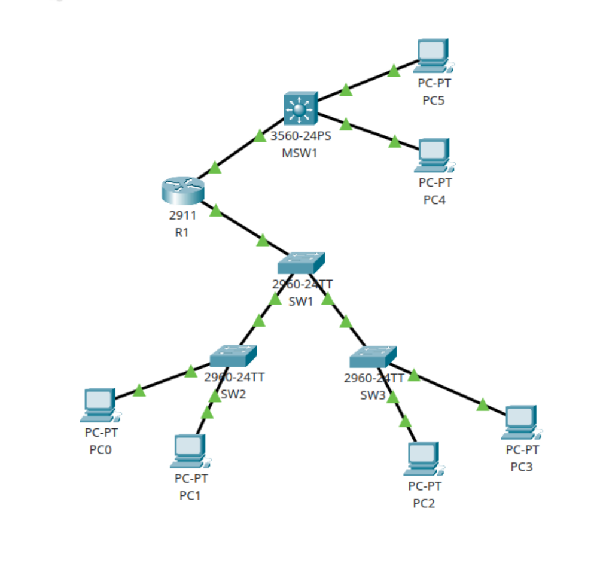
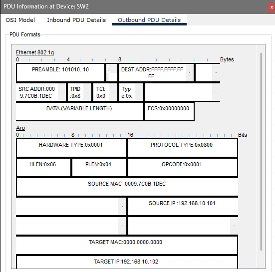
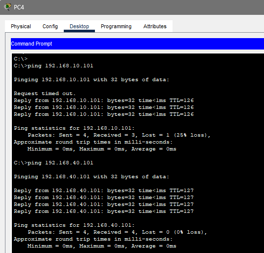

# Отчет по лабораторной работе 3
**Тема:** VLAN, маршрутизация между VLAN  
**Выполнил:** Пьянов Никита 439 группа  
**Специальность:** 09.02.06 «Сетевое и системное администрирование»  

## Топология сети


## Настройка VLAN и магистральных каналов
В ходе работы на коммутаторах SW1, SW2 и SW3 были созданы виртуальные сети VLAN 10 (STUDENTS), VLAN 20 (TEACHERS) и VLAN 99 (NATIVE). Порты, подключенные к оконечным устройствам, были переведены в режим access, а межкоммутаторные линки — в режим trunk с разрешенными VLAN 10 и 20 и нативным VLAN 99.

Для проверки конфигурации VLAN на коммутаторе SW2 был выполнен ряд команд. Список созданных VLAN:
```text
SW2# show vlan brief

VLAN Name                             Status    Ports
---- -------------------------------- --------- -------------------------------
1    default                          active    Fa0/3, Fa0/4, Fa0/5, Fa0/6
                                                Fa0/7, Fa0/8, Fa0/9, Fa0/10
                                                Fa0/11, Fa0/12, Fa0/13, Fa0/14
                                                Fa0/15, Fa0/16, Fa0/17, Fa0/18
                                                Fa0/19, Fa0/20, Fa0/21, Fa0/22
                                                Fa0/23, Gig0/1, Gig0/2
10   STUDENTS                         active    Fa0/1
20   TEACHERS                         active    Fa0/2
99   NATIVE                           active    
1002 fddi-default                     active    
1003 token-ring-default               active    
1004 fddinet-default                  active    
1005 trnet-default                    active    
```
В VLAN 10 находится только интерфейс Fa0/1:
```text
SW2# show vlan id 10

VLAN Name                             Status    Ports
---- -------------------------------- --------- -------------------------------
10   STUDENTS                         active    Fa0/1
```

Состояние магистральных портов на SW1:
```text
SW1# show interfaces trunk

Port        Mode             Encapsulation  Status        Native vlan
Fa0/23      on               802.1q         trunking      99
Fa0/24      on               802.1q         trunking      99

Port        Vlans allowed on trunk
Fa0/23      10,20
Fa0/24      10,20
```

## Анализ метки 802.1q и широковещательного трафика
При симуляции ping между PC0 и PC2 (в одном VLAN) было изучено прохождение кадра через SW2. В Inbound PDU Details Ethernet-заголовок не содержит тега. Однако в Outbound PDU Details появляется дополнительное 4-байтовое поле 802.1q tag, которое вставляется между SRC MAC и Type. Это происходит потому, что кадр отправляется в магистральный порт и должен быть помечен идентификатором VLAN.



Значение поля TCI для VLAN 10 составляет 0x000A, что в десятичной системе равно 10.

При дальнейшем анализе ARP-запросов выяснилось, что SW2 не отправляет широковещательный запрос от PC0 в сторону PC1. PC0 находится в VLAN 10, а PC1 — в VLAN 20. Так как коммутатор изолирует широковещательные домены, ARP-запрос уходит только в порты VLAN 10 (в транк-порт Fa0/24), но не в порт Fa0/2, где находится PC1.

## Маршрутизация между VLAN (Router-on-a-stick)
Для обеспечения связи между VLAN на маршрутизаторе R1 были созданы сабинтерфейсы Gi0/0.10 и Gi0/0.20 с инкапсуляцией dot1Q и IP-адресами шлюзов.

Результат проверки связности между PC0 и PC1:
```text
C:\> ping 192.168.20.101

Pinging 192.168.20.101 with 32 bytes of data:

Reply from 192.168.20.101: bytes=32 time<1ms TTL=127
Reply from 192.168.20.101: bytes=32 time<1ms TTL=127
Reply from 192.168.20.101: bytes=32 time<1ms TTL=127
Reply from 192.168.20.101: bytes=32 time<1ms TTL=127

Ping statistics for 192.168.20.101:
    Packets: Sent = 4, Received = 4, Lost = 0 (0% loss),
```

Состояние интерфейсов на R1:
```text
R1# show ip interface brief
Interface              IP-Address      OK? Method Status                Protocol 
GigabitEthernet0/0     unassigned      YES unset  up                    up      
GigabitEthernet0/0.10  192.168.10.1    YES manual up                    up      
GigabitEthernet0/0.20  192.168.20.1    YES manual up                    up      
GigabitEthernet0/1     unassigned      YES unset  administratively down down    
```

Таблица MAC-адресов на SW1:
```text
SW1# show mac address-table 
          Mac Address Table
-------------------------------------------

Vlan    Mac Address       Type        Ports
----    -----------       --------    -----
   1    0004.9ab6.3c18    DYNAMIC     Fa0/24
   1    0040.0b78.2c18    DYNAMIC     Fa0/23
  10    0009.7c0b.1dec    DYNAMIC     Fa0/23
  10    0040.0b78.2c18    DYNAMIC     Fa0/23
  10    0090.2142.dd01    DYNAMIC     Gig0/1
  20    0040.0b78.2c18    DYNAMIC     Fa0/23
  20    0090.2142.dd01    DYNAMIC     Gig0/1
  20    00e0.f70d.01d9    DYNAMIC     Fa0/23
```
В таблице видно две записи с MAC-адресом маршрутизатора R1 (0040.0b78.2c18). Это связано с тем, что R1 работает как Router-on-a-stick и имеет сабинтерфейсы для VLAN 10 и 20. Коммутатор ведет таблицу MAC отдельно для каждого VLAN, поэтому один и тот же физический MAC изучается в обоих VLAN. Записи отличаются только полем Vlan.

## Маршрутизация на многоуровневом коммутаторе
На коммутаторе MSW1 были настроены VLAN 30 и 40, созданы соответствующие SVI-интерфейсы (192.168.30.1 и 192.168.40.1) и включена маршрутизация командой `ip routing`. Порт Gi0/1 переведен в L3-режим с адресом 10.0.0.2/30. Для связи с остальной сетью на R1 и MSW1 были прописаны статические маршруты.

Была проверена связность между VLAN 30 и 40, а также сквозная маршрутизация до VLAN 10:


Таблица маршрутизации на MSW1:
```text
MSW1# show ip route
Codes: C - connected, S - static, I - IGRP, R - RIP, M - mobile, B - BGP
...
Gateway of last resort is not set

     10.0.0.0/30 is subnetted, 1 subnets
C       10.0.0.0 is directly connected, GigabitEthernet0/1
S    192.168.10.0/24 [1/0] via 10.0.0.1
C    192.168.30.0/24 is directly connected, Vlan30
C    192.168.40.0/24 is directly connected, Vlan40
```

Статус интерфейсов на MSW1:
```text
MSW1# show ip interface brief
Interface              IP-Address      OK? Method Status                Protocol 
FastEthernet0/1        unassigned      YES unset  up                    up      
FastEthernet0/2        unassigned      YES unset  up                    up      
GigabitEthernet0/1     10.0.0.2        YES manual up                    up      
Vlan30                 192.168.30.1    YES manual up                    up      
Vlan40                 192.168.40.1    YES manual up                    up      
```

## Вывод
В ходе работы были настроены VLAN и магистральные каналы с тегированием 802.1q. Реализована маршрутизация между VLAN двумя способами: Router-on-a-stick на маршрутизаторе и с помощью SVI на многоуровневом коммутаторе. Также была настроена статическая маршрутизация для обеспечения полной связности всех сегментов сети.